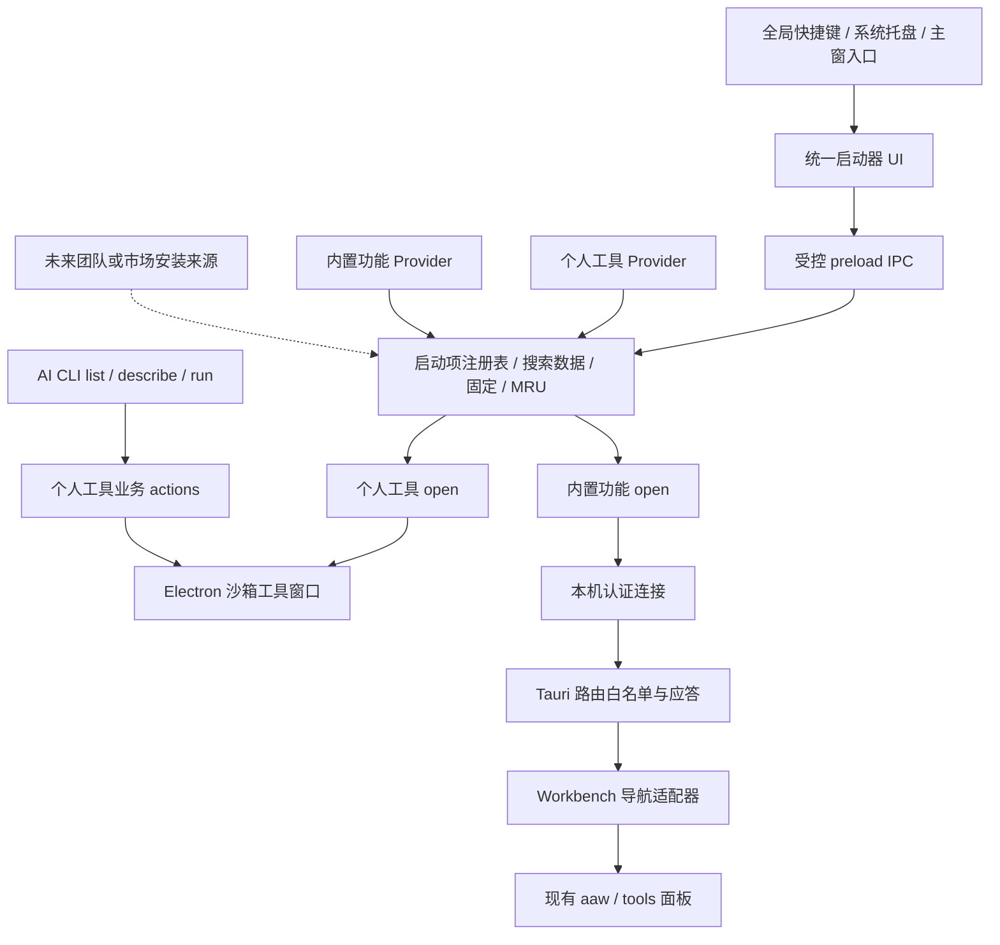

# AAW 统一启动器架构与界面重构

日期：2026-11-16；更新：2026-11-17。本文描述当前实现及明确的后续扩展边界。

## 1. 功能定位与最初需求

今天开发的是个人工具平台及其宿主能力。`src/plugins/tools` 是 AAW 内部的 Cordis 插件，提供个人工具管理页；每一个 `.aaw-tool.json` 才是用户独立开发、导入、导出的个人工具插件。Electron 宿主、全局快捷键、统一启动器和 AI CLI 是平台基础能力，随 AAW Desktop 一起交付，目前不能把整个平台导出成一个个人工具包。

主窗口继续使用 Tauri + React + Cordis。Electron 作为工具运行与小窗宿主。此轮没有将整个 AAW 主窗口迁移到 Electron。

最初需求保留：支持多个 JavaScript 个人插件、本地导入导出、主窗管理页、按近期使用排序的小窗、人和 AI 使用同一业务函数，以及未来的团队插件、共享和市场。小窗承担 AAW 的统一快捷入口，个人插件只是其中一种来源。本次已经接入 AAW 工作流与工具中心，验证内置功能和插件可以共存。

## 2. 参考图对应的界面

- 顶部使用一行搜索框，搜索名称、标识和关键词，右上角 AAW 图标进入启动器设置。
- 最近使用以图标和两行以内名称显示，默认一行，可展开。只放已成功打开的个人工具，固定内置入口不计入；新安装工具从「全部功能」找到。
- 已固定使用独立图标网格，默认包含 AAW 工作流和工具中心。悬停或键盘聚焦入口后出现星标，支持固定与取消固定。固定顺序不随最近使用排序变化。
- 「全部功能」列出所有当前可用入口。搜索同时查找个人插件与内置功能。
- 支持四方向键、Enter、Tab。Esc 先退出设置或清空搜索，再隐藏小窗。
- 默认尺寸约 860 × 410 DIP，每次召唤以鼠标所在显示器的可用区域重新计算位置及上限，给屏幕边缘留出间距。网格按容器宽度换列，长列表只滚动内容区，搜索栏和底部操作提示保持可见。
- 新增小窗采用浅色底、清晰图标和轻量选中态。工具中心沿用 AAW 主题，提供搜索、响应式卡片、独立的操作区；窄面板中标题和操作按钮换行，宽面板中卡片自动多列。
- 图片中剪贴文件、图片、市场等入口不因参考图而自动纳入本期。本期搜索占位明确写为「搜索功能、工具与工作流」。

## 3. 分层与调用关系



职责划分：

| 模块 | 当前实现位置 | 责任 |
| --- | --- | --- |
| 注册表与来源 | `tools-runtime/launcher-registry.mjs` | 注册和卸载 Provider，检测重复 ID，构建当前账号入口目录 |
| 偏好及快捷键 | 同上 | 本机配置、按账号隔离的固定与 MRU、快捷键注册和回滚 |
| 小窗宿主 | `tools-runtime/main.mjs` | 窗口、显示器适配、托盘、全局快捷键、IPC 来源校验 |
| 小窗视图 | `tools-runtime/launcher.{html,css,js}` | 搜索、图标网格、键盘导航、错误提示、设置 |
| 桌面连接 | `tools-runtime/desktop-bridge.mjs` | 带请求标识的本机路由调用，处理应答和超时 |
| 原生宿主 | `src-tauri/src/tools_runtime.rs` | 启动 Electron，提供连接及白名单，将请求交给主窗，成功后激活主窗 |
| 主窗适配器 | `src/plugins/workbench/navigation/launcher.ts` | 等待入口的 prepareGlobalOpen，然后复用已有 launcher.open 或 openTab |
| 项目上下文 | `src/plugins/project/workspace/launcherContext.ts` | 解析或选择项目、按入口策略建立或复用会话草稿 |
| 工具中心 | `src/plugins/tools/ui/ToolsPanel.tsx` | 源码 ZIP 导入导出、管理与设置、编辑预览、安装、Electron 打开、卸载 |
| 工具执行 | `tools-runtime/runtime.mjs` | 隔离运行 HTML/JS，以及隐藏窗口里的 AI action 执行 |

`tools-runtime` 保留现有目录名以兼容构建与打包路径；其中的启动器模型已经不限定为个人工具列表。

## 4. 启动项契约与扩展方法

当前入口具备以下字段：

```js
{
  id: "builtin:aaw",           // 带来源命名空间，全局唯一
  name: "AAW 工作流",
  description: "在主窗口打开当前项目的工作流",
  keywords: ["workflow", "工作流"],
  source: "builtin",            // 谁提供入口
  scope: "builtin",             // 当前归属类型；个人插件为 personal
  icon: "workflow",             // 宿主提供的图标键
  trackRecent: false,          // 固定内置功能不记录 MRU；个人工具默认记录
  recent: 0,                    // 最近成功打开的时间
  open: async () => { /* Provider 持有的受控打开函数 */ }
}
```

目录层合并 `pinned` 与 `pinOrder`，仅将可序列化的展示字段交给渲染器。`open` 留在可信 Electron 主进程。渲染器只提交入口 ID，主进程重新读取当前目录并解析 ID，避免卸载或切换账号后继续使用过期列表执行工具。

新增来源时，通过 `registry.register(providerId, () => entries)` 注册，返回的函数负责卸载。新增内置功能由可信 Provider 声明入口，同时在原生白名单和 Workbench 适配器中提供明确路由。个人工具包不能自行声明任意原生命令。

当前内置路由只有 `aaw` 和 `tools`。打开工作流仅导航到现有工作流界面，不自动启动任务，也不会复制工作流的执行引擎。主窗正在等待处理未完成操作或对应功能未注册时，返回明确错误。没有会话时自动建立会话草稿并尝试连接 agent，再打开工作流。连接失败不阻止工作流面板打开，草稿保留并展示连接原因。

后续若需要「在小窗直接展示工作流进度」或「按参数启动某个工作流」，应为来源增加明确的能力描述，例如 `open-main`、`compact-view`、`action`，并定义项目、工作流、运行实例等上下文。不能直接把所有入口当成工具 HTML 执行。

### 打开前准备：入口声明，项目服务执行

`PanelLauncher.prepareGlobalOpen?: () => Promise<string | null>` 是主窗贡献契约：入口负责声明准备策略，返回项目目录，返回 null 表示取消。Workbench 只负责寻找贡献、等待准备、检查当前生命周期及导航上下文，再打开面板。

共享项目准备策略优先选择当前导航项目、已选项目、活动项目、最近项目；检查目录存在，不存在则聚焦主窗并选择目录。AAW 调用策略时启用会话创建，工具中心关闭此选项。已有当前会话或可见草稿时复用，缺少时调用原有 `startNewSession`，同步建立可编辑草稿，异步连接 agent。不会另建一套会话服务，也不会自动启动工作流任务。

后续新增文件、审查等内置入口，在其贡献中选择上下文策略即可；不把项目或会话分支写进小窗 UI。Provider 的 `trackRecent` 则独立描述使用统计策略，避免通过名称或硬编码 UI 过滤来判断入口类型。

## 5. 主窗与 Electron 的连接

Tauri 为每次桌面进程启动生成随机 256 位令牌，并绑定 `127.0.0.1` 的临时端口。端口和令牌通过子进程环境交给可信 Electron 主进程，未暴露给个人插件或小窗渲染器。

请求使用一行 JSON，包含令牌、请求 ID 与白名单目标。原生端限制消息为 4 KB、读取与写入等待时间，并只接受 `aaw` / `tools`。收到请求后向主窗发出 `aaw://launcher-open`，主窗通过受限的 `launcher_reply` 命令回报结果。原生端等到成功应答后再显示、还原并聚焦主窗口。Electron 成功后按入口 trackRecent 策略记录最近使用并隐藏小窗，失败保留小窗显示原因。AAW 与工具中心的 trackRecent 均为 false。

原生端最多等待主窗 120 秒，Electron 请求超时为 125 秒，以容纳首次选择项目目录的时间。正常打开无需等待这段上限。用户取消目录选择视为取消导航，不弹错误。快速重启主窗时，新的单实例请求更新连接参数与父进程监控。正常退出 AAW 后，Electron 宿主通过父进程监控随之结束。

个人工具保持沙箱、上下文隔离、禁用 Node，无法使用上述宿主路由连接。这里提供的是受控导航能力，不是通用远程调用、文件访问或系统命令接口。

单独运行 `npm run tools:launcher` 可以调试小窗和个人工具；没有主窗连接时，点击内置入口会提示从 AAW Desktop 打开小窗。

## 6. 状态、排序和快捷键

- 快捷键默认为 **Alt+Space**，在小窗右上角或底部快捷键入口设置，保存后立即生效，支持恢复默认。
- 新快捷键先尝试注册，再原子保存配置，最后注销旧快捷键。冲突或保存失败时保留原设置，避免用户失去唤起入口。
- 启动时若快捷键被其他应用占用，小窗会显示状态，托盘仍可打开。Alt+Space 与 Windows 默认系统菜单组合存在重合，实际能否注册以 Electron 的返回结果为准。
- `launcher-settings.json` 放在 AAW 本机数据根目录。快捷键属于本机偏好，`users[owner]` 保存对应账号的 `pinned` 和 `recent`。
- 个人安装包继续读取 AAW 配置文件，遵循已配置的数据存储位置。启动器自身偏好保留在本机数据根，不随插件导出。
- 最近使用合并主窗个人工具记录、Electron 的个人工具记录及统一启动器记录，按时间降序。未打开过的入口不占最近使用区。失败不写入最近使用。AAW 和工具中心强制 recent=0，历史版本已记录的内置 MRU 不再展示，新调用也不再写入。用户固定的个人工具仍可正常进入最近使用。
- CLI 的自动化执行不会挤占人工最近使用列表。
- 每次显示小窗重新读目录，导入、卸载或切换账号后下次召唤即可更新。当前未实现小窗持续可见时的安装清单推送。

## 7. 给后续人类与 AI 开发者的约定

插件继续使用统一的 `.aaw-tool.json` 契约。可供 AI 使用的业务能力放在 `window.aawActions[actionId]`，按钮和 CLI 调用同一函数。使用明确的 JSON 输入输出，校验参数，区分无副作用的转换与会改变状态的动作。详细开发说明见 `personal-tools.md`。

本次新增的内置工作流入口是界面导航，尚未把工作流业务动作注册成个人工具 CLI actions。后续应围绕已有工作流服务设计动作契约，再向 UI 与 AI 同时开放，避免让 AI 依赖模拟点击来执行流程。

插件自身界面要适应容器而非假设固定屏幕大小。宿主注入 viewport，工具作者应使用弹性布局、可滚动内容、可换行操作区和清晰的错误状态。宿主只能适配窗口和容器，无法自动修复任意第三方插件内写死的像素布局。

## 8. 团队、共享与市场的后续演进

目前实际来源是 `builtin` 与 `personal`。团队插件、市场、共享服务、远程下载、签名验证和组织权限尚未实现。

建议后续以安装来源、权限归属和运行能力三个独立维度扩展：

1. 安装记录增加来源（本地/市场/组织分发）与版本来源，保持插件 ID 稳定。
2. 归属扩展为个人或团队，明确账号/团队切换、可见性、授权和撤销规则。
3. Provider 依据当前身份返回可见入口，注册表统一完成搜索、最近使用和固定展示。
4. 运行时独立校验权限。禁止仅凭 `scope: team` 就放行网络、文件或原生能力。
5. 市场承担分发和审核，安装后的入口仍复用现有启动项模型与个人工具运行契约。

## 9. 验证与范围

已运行：TypeScript 检查、相关 ESLint、Vite 构建、Rust Windows debug 构建、全量 Vitest（2026-11-17：262 个文件、1,973 项通过）、注册表/账号隔离/固定/MRU/快捷键回滚测试、真实 Electron CLI 冒烟测试。

新增 `scripts/test-launcher-ui.mjs` 在独立临时账号中启动真实 Electron，验证 20 个入口（18 个测试工具与 2 个内置入口）、搜索、固定、展开、约 860×410 和 360×300 尺寸无横向溢出、底部操作可见、自定义快捷键保存、冲突保留原快捷键，以及独立启动时的主窗连接提示。

上一轮 Windows 人工界面路径验证过 Alt+Space、混合入口和主窗路由。2026-11-17 新增自动创建会话的逻辑已通过项目服务与导航测试；最新原生构建成功，但 Windows 自动化接口返回 `foreground window did not report a process id`，重试失败，因此尚未完成新构建上从小窗点击 AAW 的整链人工验收。真实 Electron 自动化已验证插件打开、已保存设置生效和 CLI 输出；新增管理页通过 6 项浏览器布局/交互验收（深浅主题、360/740/1100 像素）。本机原有 icode 不可用，尚未验证依赖该 agent 的真实会话连接与工作流执行。

本轮只调整新增工具界面与启动器。未进行 NSIS 安装/升级测试，也未验证 macOS 或 Linux 的系统快捷键行为。所有代码仅本地提交，不推送远端。

## 10. 开发与复测

```powershell
# desktop 目录
npm.cmd run tools:build
node --test scripts/test-launcher.mjs
node scripts/test-launcher-ui.mjs
npm.cmd run tools:test
npm.cmd run typecheck
npm.cmd test
npm.cmd run build
```

修改 Electron 源码后需重新构建并重启桌面宿主。主窗 React UI 由 Vite 开发服务器更新。原生桥接改动还需重新构建 Tauri debug 程序。

官方依据：[Electron globalShortcut](https://www.electronjs.org/docs/latest/api/global-shortcut) 说明注册会因组合键被其他应用占用而失败，设置流程必须检查返回值并提供可用的托盘入口。
